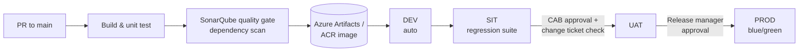

# Banking Azure DevOps Pipelines

**Audit-ready, multi-stage Azure DevOps YAML pipelines for banking microservices.**

A reference implementation of the release platform I build for regulated financial services: reusable YAML templates, Terraform-provisioned environments, Key Vault-backed secrets, quality gates and approval-controlled promotion with full audit traceability.

> Showcase project. It reflects patterns I've used on enterprise banking engagements, with every client-specific detail removed.

## Pipeline flow



## Highlights

| Capability | How |
|---|---|
| Reusable templates | `templates/` hold build, scan, Terraform and deploy stages designed to be shared across services |
| Environments as code | Terraform per environment (`infra/envs/*.tfvars`) with remote state in Azure Storage |
| Secrets | Azure Key Vault variable groups + managed identities; zero plain-text credentials in YAML |
| Quality gates | SonarQube quality gate, vulnerable-package gate and published test coverage |
| Change management | Azure DevOps Environments with approvals and checks (business hours, required change ticket) |
| Release safety | Versioned packages, blue/green slot swap on AKS, rollback under 15 minutes |
| Traceability | Work items linked to commits, build retention, per-environment deployment history |

## Repository layout

```
azure-pipelines.yml            entry pipeline: stages and promotion order
templates/build.yml            .NET build, test, coverage, container image
templates/security-scan.yml    SonarQube + dependency scanning gate
templates/terraform.yml        plan/apply with remote state and manual review of plan
templates/deploy-aks.yml       Helm deploy with blue/green and smoke tests
infra/                         Terraform: resource group, Key Vault, managed identity, Log Analytics, App Insights
scripts/health-check.ps1       post-deployment verification
docs/branching-strategy.md     trunk-based flow, release branches, semantic versioning
```

## Setup

1. Create service connections `sc-azure-<env>` using workload identity federation.
2. Create variable groups `vg-<env>` linked to the environment's Key Vault.
3. Create Azure DevOps Environments `dev`, `sit`, `uat`, `prod` and add approvals and checks to `uat` and `prod`.
4. Point a new pipeline at `azure-pipelines.yml`.

---
Author: **Vamsikrishna Gollapudi** · Azure DevOps & SRE · [Portfolio](https://vamsikrishna85.github.io/my-profile/)
